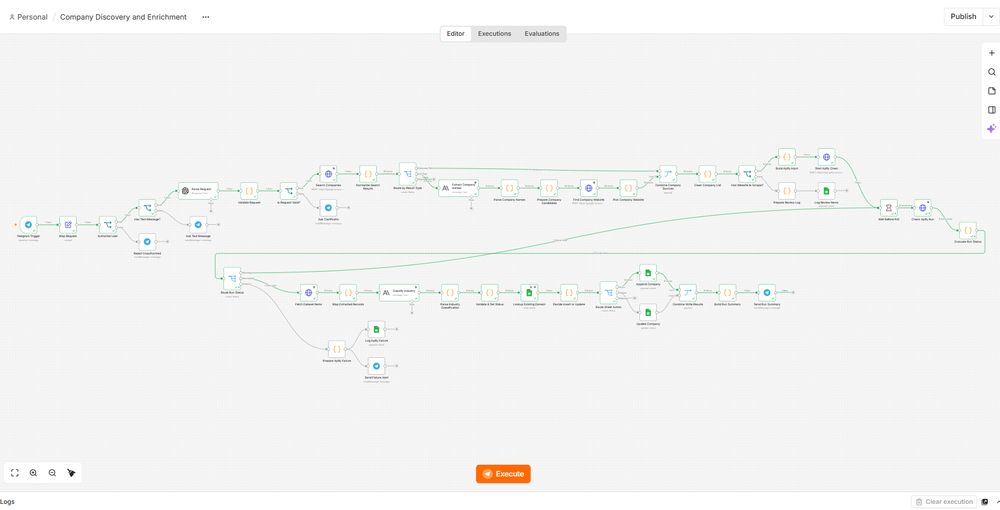
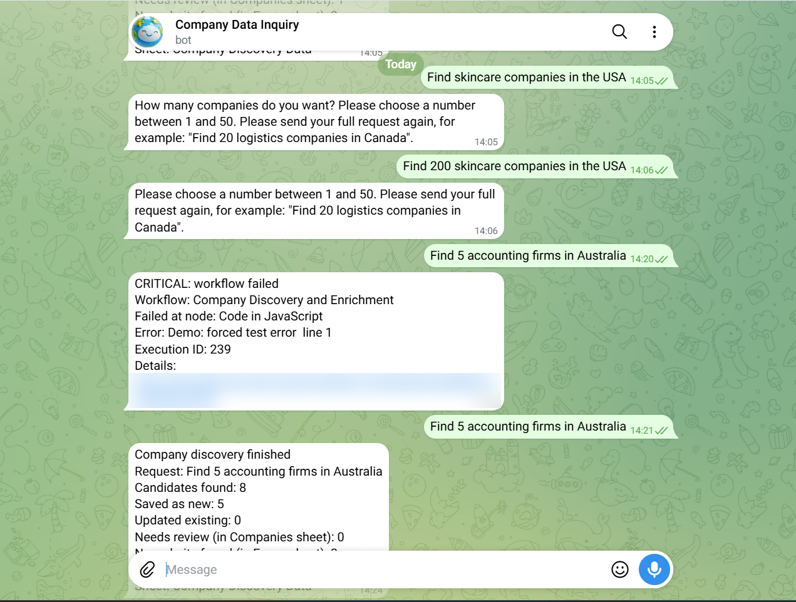
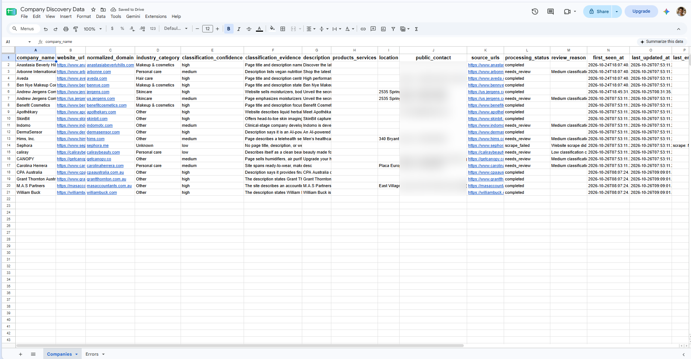

# AI-Powered Company Discovery & Data Enrichment (n8n)

Send a plain-language request to a Telegram bot, for example **"Find 5 accounting firms in Australia"**, and get a clean, deduplicated company list in Google Sheets.

> Personal practice project built while learning n8n and AI automation. It is not client work.

**Demo video:** <!-- paste your LinkedIn post link here -->

## Screenshots

**Workflow canvas (45 nodes)**


**Telegram: validation, error alert and run summary**


**Google Sheets output** (the `public_contact` column is blurred in this screenshot)


## What it does

1. Receives a natural-language request in Telegram and checks the sender against an allowlist.
2. Parses the request with an LLM into `company_type_or_niche`, `geography` and `requested_count`, and asks for clarification when something is missing or invalid.
3. Searches with Serper.dev, classifies each result as company site, list page or skip, and extracts company names from list pages with an LLM.
4. Finds each company's official website, removes duplicates by normalized domain, and caps the list at the requested count.
5. Scrapes the homepages with the Apify Website Content Crawler (asynchronous run, status polling).
6. Extracts the available fields, classifies the industry with an LLM, validates the record and sets a processing status.
7. Looks up each domain in Google Sheets and inserts a new row or updates the existing one.
8. Logs problems to an Errors tab, retries transient failures, and sends a Telegram summary. A separate Error Handler workflow sends admin alerts for unhandled failures.

## Architecture

```
Telegram Trigger -> Map Request -> Authorize User -> Has Text Message?
  -> Parse Request (LLM) -> Validate Request -> Is Request Valid?
  -> Search Companies (Serper) -> Normalize Search Results -> Route by Result Type
       |- Company Site -----------------------------------.
       |- List Page -> Extract Company Names (LLM)        |
       |     -> Parse Company Names -> Prepare Company    |
       |     Candidates -> Find Company Website           |
       |     -> Pick Company Website ----------------------> Combine Company Sources
       '- Skip                                            '
  -> Clean Company List -> Has Website to Scrape?
       |- true: Build Apify Input -> Start Apify Crawl -> Wait Before Poll
       |     -> Check Apify Run -> Evaluate Run Status -> Route Run Status
       |     (running: loop back | succeeded: Fetch Dataset Items | other: failure alert)
       |     -> Map Extracted Records -> Classify Industry (LLM) -> Parse Industry Classification
       |     -> Validate & Set Status -> Lookup Existing Domain -> Decide Insert or Update
       |     -> Route Sheet Action -> Append Company / Update Company
       |     -> Combine Write Results -> Build Run Summary -> Send Run Summary
       '- false: Prepare Review Log -> Errors tab (no website found)

Separate workflow: Error Trigger -> Sanitize Error -> Log Workflow Error + Send Admin Alert
```

## Tech stack

| Part | Tool |
|---|---|
| Orchestration | n8n (built on n8n Cloud) |
| Input and notifications | Telegram Bot |
| Discovery | Serper.dev Search API |
| Scraping | Apify, `apify/website-content-crawler` |
| Request parsing | OpenAI node (`gpt-4o-mini`) |
| Name extraction and industry classification | Anthropic node (`claude-haiku-5-5`) |
| Storage | Google Sheets |
| Transformations | JavaScript Code nodes |

## Data model

**Companies tab** (one row per normalized domain): company name, website URL, normalized domain, industry category, classification confidence, classification evidence, description, products/services, location, public contact, source URLs, processing status, review reason, first seen at, last updated at, last error.

**Errors tab:** timestamp, workflow name, execution ID, stage, company URL, error code, sanitized error message, retry count, resolved status.

**Processing statuses:** `completed`, `needs_review`, `scrape_failed`, `validation_failed`.

**Industry list used in this version:** Skincare, Hair care, Makeup & cosmetics, Personal care, Other, Unknown. Low or medium confidence and `Unknown` always go to `needs_review`.

## Design decisions

- **Normalized domain is the key.** Reruns update existing rows and keep `first_seen_at`.
- **Nothing is invented.** Missing data stays empty. Public contact details are saved only when the site shows them.
- **Uncertain records are flagged,** not marked complete.
- **Bounded retries:** Retry On Fail with 3 tries on external-call nodes. `Start Apify Crawl` has no retry, to avoid paying for duplicate runs.
- **Rate limits:** Serper allows about 5 requests per second, so `Find Company Website` uses the HTTP Request batching option (batches of 3).
- **Cost guards:** `maxTotalChargeUsd` on the Apify run, a requested-count limit of 1 to 50, and the authorization check before any paid API call.
- **Safe errors:** the error workflow removes tokens and authorization values before logging or alerting.

## Setup

1. **Google Sheet:** create a spreadsheet with a `Companies` tab and an `Errors` tab and add the header rows listed above, in the same order your Sheets nodes map them.
2. **Import** `workflows/company-discovery-error-handler.json` first, then `workflows/company-discovery-and-enrichment.json` (Workflow -> Import from File).
3. **Create credentials in n8n and attach them to the nodes.** The exported files contain no credentials, so n8n will ask you to select them:
   - Telegram Bot token (trigger and all Telegram nodes)
   - Serper API key as a Header Auth credential (`Search Companies`, `Find Company Website`; header name and value as described in the Serper docs)
   - Apify API token as a Header Auth credential (`Start Apify Crawl`, `Check Apify Run`, `Fetch Dataset Items`; header format as described in the Apify docs)
   - Google Sheets OAuth2 (all Google Sheets nodes)
   - OpenAI API key (`Parse Request`) and Anthropic API key (`Extract Company Names`, `Classify Industry`). The original build used n8n AI gateway credits, so attach your own keys
4. **Replace the placeholders:**
   - allowed Telegram user ID in `Authorize User` (currently `0`)
   - `ADMIN_CHAT_ID` in `Sanitize Error` (Error Handler workflow, currently `0`)
   - `YOUR_SPREADSHEET_ID` in every Google Sheets node, in both workflows
5. **Publish** the Error Handler workflow, then select it under the main workflow's Settings -> Error Workflow, then publish the main workflow. The Telegram trigger only works on a published workflow.
6. Send a message to your bot, for example `Find 5 skincare companies in the USA`.

## Settings you can tune

| Setting | Where | Current value |
|---|---|---|
| Candidate buffer | `Prepare Company Candidates` -> `BUFFER_FACTOR` | 2 |
| Poll limit | `Evaluate Run Status` -> `MAX_POLLS` | 30 |
| Poll interval | `Wait Before Poll` | 20 s |
| Apify run timeout | `Start Apify Crawl` -> `timeout` | 600 s |
| Apify cost cap | `Start Apify Crawl` -> `maxTotalChargeUsd` | 1 |
| Crawl scope | `Build Apify Input` | homepage only (`maxCrawlDepth` 0) |

## Test results

| Test | Result |
|---|---|
| Greeting / no company type | Asks what type of companies to look for |
| Count of 200 | Rejected, asks for a number from 1 to 50 |
| Missing count, "near me" location | Asks for the count or the city/country |
| Real sticker (non-text message) | Asks for a text message, no paid API called |
| Unauthorized Telegram user | Rejected before any paid API call |
| Rerun of the same search | Existing rows updated, no duplicate rows |
| Different niches | Skincare, logistics, coffee roasters, accounting firms |
| Forced error | Admin alert received, error logged |

One measured run: 15 requested skincare companies finished in about 9 minutes. The Apify crawl for 15 sites took about 7 minutes 22 seconds and cost about $0.21.

## Known limitations

- **Larger runs:** with a 600 s Apify timeout and 600 s of polling, runs above roughly 20 companies may time out. The fix is to split companies into batches of about 10 per Apify run.
- **Industry list is skincare-centred.** Other niches mostly come back as `Other`. A configurable taxonomy is the next step.
- **No relevance check:** some results may not match the requested niche (for example, retailers or clinics in a skincare search).
- **Subdomain duplicates:** `jergens.com` and `us.jergens.com` count as different domains.
- **LLM variation:** the same company can get a different category or confidence between runs.
- **Fewer results than requested** is normal when searches find few usable websites.
- **Google Sheets is not transactional.** For concurrent or large-scale use, move to a database with a unique constraint on the domain.
- **Respect site terms:** only public pages are scraped, homepage only, and privacy rules and website terms still apply.

## Possible improvements

Batched Apify runs, configurable taxonomy, niche-relevance scoring, subdomain-aware deduplication, CRM delivery once a CRM is chosen.

## Author

MD Mustafizur Rohman, AI Automation & n8n Workflow Developer
GitHub: https://github.com/md-mustafizur
LinkedIn: https://www.linkedin.com/in/md-mustafizur-rohman-19b9163b5
